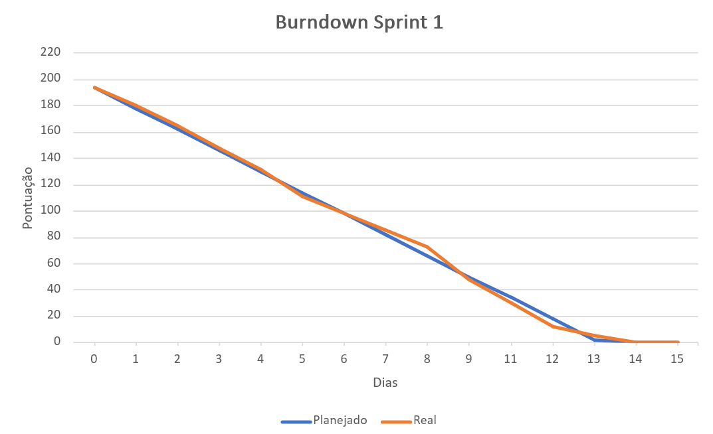

## Sprint 1 - GreenER

### Objetivo da sprint
O objetivo geral dessa sprint era entregar todos os designs iniciais, diagramas UML, implementação das primeiras telas, base do servidor backend e banco de dados.

- Design e prototipação -> com a ideia de uma interface simples e intuitiva para o cliente.  

- Diagramas UML -> Também desenvolver os diagramas UML, como o de caso de uso, diagrama de classe e diagramas de sequência, contribuindo no entendimento da proposta do projeto e em como integrar cada parte da aplicação com POO (Programação Orientada a Objetos).  

- Implementação telas -> Implementar 3 telas no site: landing page, login e tela principal. Como essas são as primeiras telas que o usuário acessa, demos prioridade a elas nessa sprint.  

- Servidor backend -> Desenvolver um servidor backend simples, que tenha como funcionalidades: cadastrar e listar usuários e históricos. Tudo isso por meio dos endpoints, que serão acessados pelas telas da aplicação.

- Banco de dados -> Modelo do banco de dados e código SQL para usar no desenvolvimento e iniciar com o Docker Compose.

- Testes -> Instalar dependências e desenvolver ao menos 2 testes de implantação, para testar a integridade das rotas de cadastro de usuário e de histórico. 

 

### O que foi entregue
O **vídeo** desenvolvido pela equipe para a sprint pode ser acessado nesse link: [clique aqui](https://youtu.be/no3dPzF96Jo).  
Ele mostra visualmente o que foi feito das documentações, telas, design e backend, e o que está planejado para o próximo ciclo de entrega.

A seguir está o burndown da sprint 1.  
Ele demonstra a evolução das tarefas ao longo dos dias. Assim como a relação entre o esforço real de cada dia e o planejado.  
No início da sprint, foi definido um esforço total de 194. E para cada dia, uma média de 16 pontos esperados.

 

Lista do que foi entregue:
- [ ✔ ] Design e prototipação de todas as telas
- [ ✔ ] Diagramas UML (caso de uso, classes e sequência)
- [ ✔ ] Implementação das telas definidas
- [ ✔ ] Servidor backend básico
- [ ✔ ] Banco de dados
- [ ✔ ] 2 testes de implementação

 

### Itens concluídos e pendentes
Não houve nenhuma tarefa pendente que foi determinada no Sprint Backlog, portanto, todas as tarefas foram *concluídas*.

É possível acessar o Kanban da sprint [neste link](https://github.com/users/atmosabp/projects/1/views/1).

### Sprint Backlog

| ID       | Descrição                                                        | Autor          | Disciplina | Esforço |
| :------- | :--------------------------------------------------------------- | :------------- | :--------- | :------ |
| **BD01** | Modelar banco de dados                                           | Darcy          | BDR        | 2       |
| **BD02** | Criar banco de dados                                             | Mariana        | BDR        | 2       |
| **BD03** | Criar conexão do banco ao backend                                | kauã           | BDR        | 5       |
| **DD01** | Definir identidade visual (cores, fontes e logo)                 | All            | DD         | 3       |
| **DD02** | Desenvolver logo do projeto                                      | Júlia          | DD         | 3       |
| **DD03** | Desenvolver logo da equipe                                       | Júlia          | DD         | 3       |
| **DD04** | Tela de cadastro - Desktop                                       | Beatriz        | DD         | 3       |
| **DD05** | Tela de cadastro - Mobile                                        | Beatriz        | DD         | 1       |
| **DD06** | Tela de login - Desktop                                          | Júlia          | DD         | 5       |
| **DD07** | Tela de login - Mobile                                           | Júlia          | DD         | 1       |
| **DD08** | Tela principal - Desktop                                         | Lorenzo        | DD         | 8       |
| **DD09** | Tela principal - Mobile                                          | Lorenzo        | DD         | 2       |
| **DD10** | Tela dashboard - Desktop                                         | Beatriz        | DD         | 5       |
| **DD11** | Tela dashboard - Mobile                                          | Beatriz        | DD         | 2       |
| **DD12** | Tela de ranking - Desktop                                        | Mariana        | DD         | 5       |
| **DD13** | Tela de ranking - Mobile                                         | Mariana        | DD         | 3       |
| **DD14** | Tela de comparação - Desktop                                     | Kauã           | DD         | 3       |
| **DD15** | Tela de comparação - Mobile                                      | Kauã           | DD         | 2       |
| **DD16** | Tela 404 - Desktop                                               | Mariana        | DD         | 2       |
| **DD17** | Tela 404 - Mobile                                                | Mariana        | DD         | 1       |
| **DD18** | Tela Landing Page - Desktop                                      | kauã           | DD         | 3       |
| **DD19** | Tela Landing Page - Mobile                                       | kauã           | DD         | 2       |
| **DD20** | Definir avisos (loading, avisos, erros)                          | Mariana        | DD         | 3       |
| **DW01** | Criar estrutura do projeto frontend                              | Lorenzo        | DW II      | 5       |
| **DW02** | Implementar tela principal                                       | Lorenzo        | DW II      | 13      |
| **DW03** | Implementar tela de login                                        | Beatriz        | DW II      | 5       |
| **DW04** | Implementar landing page                                         | Beatriz        | DW II      | 3       |
| **ES01** | Criar e manter Product Backlog                                   | Beatriz        | ESW II     | 3       |
| **ES02** | Criar Sprint Backlog referente a 1° sprint                       | All            | ESW II     | 5       |
| **ES03** | Criar vídeo referente a 1° sprint                                | All            | ESW II     | 8       |
| **ES04** | Criar relatório da 1° sprint                                     | Júlia          | ESW II     | 5       |
| **ES05** | Criar e manter Burn da 1° sprint                                 | Júlia          | ESW II     | 2       |
| **ES06** | Criar e manter README.md                                         | Júlia          | ESW II     | 3       |
| **ES07** | Desenvolver User Story + critérios de aceitação                  | Kauã           | ESW II     | 2       |
| **ES08** | Criar DoD                                                        | Lorenzo        | ESW II     | 5       |
| **ES09** | Criar Diagrama de Caso de Uso                                    | Darcy          | ESW II     | 5       |
| **ES10** | Criar Diagrama de Sequência                                      | Darcy          | ESW II     | 8       |
| **ES11** | Conteinizar o projeto                                            | Júlia          | ESW II     | 3       |
| **ES12** | Criar Diagrama de Classes                                        | Mariana        | ESW II     | 8       |
| **TP01** | Criar estrutura do backend em módulos (controllers, services...) | Lorenzo        | TP I       | 3       |
| **TP02** | Configurar servidor HTTP e variáveis de ambiente                 | kauã           | TP I       | 2       |
| **TP03** | Consultar /services                                              | Darcy          | TP I       | 2       |
| **TP04** | Consultar /metrics/{id_servico}                                  | Darcy          | TP I       | 5       |
| **TP05** | Implementar cálculo de CO₂e                                      | Darcy          | TP I       | 3       |
| **TP06** | Consultar Carbon Intensity API                                   | Kauã           | TP I       | 5       |
| **TP07** | Calcular consumo total                                           | Kauã           | TP I       | 8       |
| **TP08** | Calcular emissão total                                           | Darcy          | TP I       | 5       |
| **TP09** | Calcular serviços ativos e indisponíveis                         | Darcy          | TP I       | 5       |
| **TP10** | Criar endpoints                                                  | Mariana        | TP I       | 2       |
| **TP11** | Implementar testes                                               | Júlia, Mariana | TP I       | 5       |

 

### Verificações realizadas
Durante a sprint, foi desenvolvido um relatório descrevendo o que foi feito em cada dia de trabalho para cada integrante, e outras informações adicionais.

Aqui está o link para o relatório da sprint: [clique aqui](https://github.com/atmosabp/greener/blob/develop/docs/relatorios/relatorio-sprint-1.md)

 

### Sprint Retrospective
Este é um evento da metodologia Scrum que permite que a equipe se junte e dialogue sobre o processo, sem focar no produto. Seguimos um formato para falar o que não deu certo, o que deu certo, e o que podemos fazer para melhorar. Garantindo que levamos tudo o que foi discutido em consideração para ter um processo (e consequentemente, um produto) muito melhor.  
Essa reunião aconteceu dia **20 de outubro**. Esses foram os pontos levantados:

#### 1 - O que não deu certo 
- Vários pull requests levavam tempo demais para ser fechados, o que levava em atrasos nas outras tarefas, pois dependiam de tarefas que já eram para estar concluídas, e virava uma bola de neve, atrasando o design, implementação de telas e backend.
- Falta de comunicação dos pull requests. Quando alguém criava um pull request ou aprovava um, até a pessoa esperada notar isso, demorava muito, e também atrasava a completar outras tarefas.
- Houve muito perfeccionismo nas tarefas, especificamente de design. Em teoria é algo bom ter tarefas muito bem desenvolvidas, mas para o design não é necessário deixar tudo perfeito logo na primeira sprint, pois com certeza ainda haverá muitas mudanças até o final do projeto.

#### 2 - O que deu certo
- Todos foram muito dedicados, mesmo em tarefas que eram difíceis de ser feitas, todos tentavam se empenhar o máximo possível.
- O design ficou mais harmonioso do que planejado inicialmente.
- O time foi muito unido, então sempre alguém podia ajudar o outro em alguma tarefa que tinha dificuldade, ajudando a acelerar na entrega e no aprendizado.
- Produto no final da sprint ficou como planejávamos, e conseguimos concluir todas as tarefas a tempo por conta da organização.

#### 3 - Como podemos melhorar
- Se comunicar por outros meios (como WhatsApp, Discord ou pessoalmente) no momento que for feito um Pull Request ou ter sido avaliado um. Isso fará com quem tiver feito o pull request ou as pessoas que revisam ele notarem mais rápido, e agilizar no processo de aprová-lo.
- Mudar formato da daily, para todos compartilharem o que foi feito no dia anterior, o que estão fazendo e o que irão fazer, proporcionando mais comunicação entre a equipe, e noção do andamento do projeto.
- Utilizar mais o Kanban, pois é uma ferramenta que ainda pode ser muito explorada.
- Canal de bug reports no Discord para reportar bugs e erros encontrados durante testes, para facilitar todos a corrigirem os erros, e planejar quando irão arrumá-los.
- Estimar prazo de finalização das tarefas sempre que alguma for iniciada, para ter uma noção de quando as tarefas dependentes dela serão feitas, e agilizar mais o processo.
- Testar a aplicação no tempo ocioso de trabalho. Isso ajuda a encontrar bugs mais efetivamente e sempre garantir que a aplicação sempre está funcionando como deveria (sem contar os testes automatizados que serão criados, pois eles só cobrem parte).

 

---

 

    <i> Desenvolvido por Atmos  2026</i>

