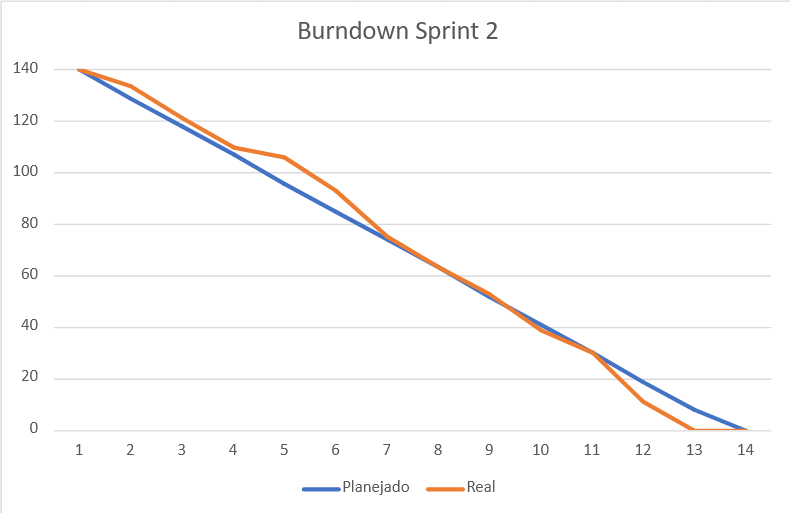

## Sprint 2 - GreenER

Esta sprint ocorreu entre os dias **20/11/2026** e **09/11/2026**. Excluindo os dias que foram decididos não serem dias de desenvolvimento, teve a duração total de 16 dias.

### Objetivo da sprint
O objetivo geral dessa sprint era implementar todas as telas do site, como a tela principal e o dashboard, desenvolver o sistema de guardar métricas dos serviços no banco de dados e implementar sistema de segurança.  

Aqui está cada objetivo em mais detalhes:

- **Implementação e integração de telas** -> Implementar 3 telas no site: landing page, login e tela principal. Como essas são as primeiras telas que o usuário acessa, demos prioridade a elas nessa sprint.  

- **Servidor backend** -> Desenvolver um servidor backend funcional, que tenha quase todas as partes necessárias para o projeto inteiro: rotas, funções para pegar dados da API, autenticação com JWT e criptografia de senhas. 

- **Sistema de coleta de histórico** -> Desenvolver o sistema de coleta de histórico no servidor, para guardar no banco de dados o histórico de métricas de todos os serviços. Também desenvolver os triggers para garantir um desempenho maior na coleta de dados, separando-os em tabelas de minutos, horas, dias e meses.

- **Testes** -> Desenvolver os testes de endpoints restantes, de acordo com o possível e necessário, pois pode haver alguns que dependem de implementações da 3° sprint.

 

### O que foi entregue
O **vídeo** desenvolvido pela equipe para a sprint pode ser acessado nesse link: [clique aqui](https://youtu.be/JRwsLX7Vka0).  
Ele mostra visualmente o que foi feito durante a sprint das telas e backend, e o que está planejado para o próximo ciclo de entrega.

A seguir está o burndown da sprint 2.  
Ele demonstra a evolução das tarefas ao longo dos dias. Assim como a relação entre o esforço real de cada dia e o planejado.  
No início da sprint, foi definido um esforço total de 140 pontos. E para cada dia, uma média de 11 pontos esperados.

 

Lista do que foi entregue:
- [ ✔ ] Implementação de todas as telas planejadas, e integração delas com o backend (servidor que liga os dados da API).
- [ ✔ ] Autenticação de usuários por meio de JWT e criptografia de senhas para segurança
- [ ✔ ] Banco de dados aprimorado com o sistema de triggers para melhorar desempenho do histórico
- [ ✔ ] Todos os testes de implementação viáveis no escopo atual

 

### Itens concluídos e pendentes
Não houve itens pendentes nessa sprint. Tudo o que foi realmente planejado foi concluído.

É possível acessar o Kanban da sprint [neste link](https://github.com/users/atmosabp/projects/3).

### Sprint Backlog

| ID       | Descrição                                                            | Autor   | Disciplina | Esforço |
| :------- | :------------------------------------------------------------------- | :------ | :--------- | :------ |
| **BD04** | Criar estrutura para armazenar histórico das coletas         | Darcy   | BDR        | 8       |
| **DW05** | Implementar validação de login (conexão front com back)     | Lorenzo | DW II        | 3       |
| **DW05** | Implementar tratamento de erros no cadastro (conexão front com back) | Lorenzo | DW II        | 3       |
| **DW05** | Implementar tratamento de erros no login (conexão front com back)    | Beatriz | DW II        | 3       |
| **DW06** | Implementar logout         | Lorenzo | DW II        | 2       |
| **DW07** | Implementar dashboard       | Beatriz    | DW II        | 5       |
| **DW07** | Conectar backend das APIs na dashboard       | Júlia | DW II        | 3       |
| **DW08** | Implementar atualização dos dados na tela principal (conexão front com back)            | Júlia    | DW II        | 5       |
| **DW09** | Implementar estados de loading e erro (geral - conexão front com back)        | Júlia    | DW II        | 3       |
| **DW09** | Implementar estados de loading e erro (geral - frontend)                  | Beatriz    | DW II        | 3      |
| **DW10** | Implementar tela de ranking         | Lorenzo    | DW II        | 5       |
| **DW10** | Conectar backend na tela de ranking      | Darcy    | DW II        | 5       |
| **DW11** | Implementar tela de comparação     | Lorenzo    | DW II        | 8       |
| **DW11** | Conectar backend na tela de comparação        | Kauã    | DW II        | 8       |
| **DW12** | Implementar tela de cadastro/admin  | Beatriz    | DW II        | 5       |
| **DW12** | Conectar backend na tela de cadastro/admin   | Lorenzo  | DW II   | 5       |
| **ES06** | Manter README.md    | Júlia    | ESW II      | 1       |
| **ES13** | Criar Sprint Backlog referente a 2° sprint  | Todos    | ESW II   | 5       |
| **ES14** | Criar vídeo referente a 2° sprint   | Todos    | ESW II        | 8       |
| **ES16** | Criar e manter burndown da 2° sprint     | Júlia    | ESW II        | 2       |
| **ES17** | Documentar endpoints desenvolvidos pela equipe     | Mariana    | ESW II        | 3       |
| **ES17** | Documentar orientações para configurar o acesso às APIs auxiliares      | Darcy    | ESW II        | 2       |
| **ES17** | Desenvolver README da pasta `frontend/`  | Kauã    | ESW II  | 2   |
| **ES17** | Desenvolver README da pasta `backend/`  | Kauã    | ESW II        | 3       |
| **ES17** | Desenvolver README da pasta `database/`  | Mariana    | ESW II        | 1       |
| **TP12** | Implementar autenticação com JWT      | Lorenzo    | TP I        | 3      |
| **TP13** | Detectar alterações na lista de serviços   | Mariana    | TP I    | 5     |
| **TP14** | Detectar serviços sem métricas    | Mariana    | TP I        | 3       |
| **TP15** | Persistir métricas coletadas no banco de dados     | Darcy    | TP I  | 2  |
| **TP16** | Criar mecanismo de coleta periódica   | Darcy    | TP I        | 5       |
| **TP17** | Tratar coordenadas ausentes  | Kauã    | TP I        | 5       |
| **TP18** | Criar mais endpoints   | Mariana    | TP I        | 3    |
| **TP19** | Continuar testes de implementação (endpoints)     | Júlia e Mariana    | TP I        | 8  |
| **TP20** | Criar testes automatizados (GitHub Actions)   | Júlia e Mariana    | TP I        | 5       |

 

### Verificações realizadas

Durante a sprint, foi desenvolvido um relatório descrevendo o que foi feito em cada dia de trabalho para cada integrante, e outras informações adicionais.

Aqui está o link para o relatório da sprint: [clique aqui](https://github.com/atmosabp/greener/blob/develop/docs/relatorios/relatorio-sprint-2.md)

 

### Sprint Retrospective
Este é um evento da metodologia Scrum que permite que a equipe se junte e dialogue sobre o processo, sem focar no produto.

Como é feito apenas após o encerramento da Sprint Review, ainda não foi adicionado aqui.

 

---

 

    <i> Desenvolvido por Atmos  2026</i>

